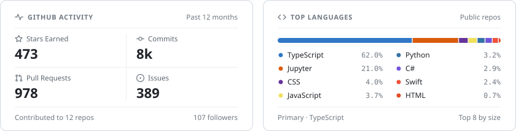
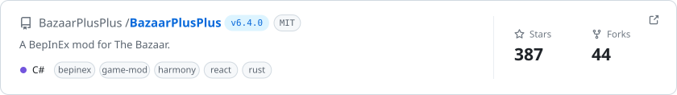

### Hi, I'm Xinyu

Engineer at [ByteDance](https://github.com/bytedance), exploring graph embeddings, NLP, and LLMs.
Occasional notes in [Modest Understandings on LLM](https://bytedance.feishu.cn/docx/doxcn3zm448MK9sK6pHuPsqtH8f).

**Focus** &nbsp;·&nbsp; Python · CUDA / C++ · Writing bugs 
**Links** &nbsp;·&nbsp; [yangxinyu.715@bytedance.com](mailto:yangxinyu.715@bytedance.com) · [Bilibili @小杨不努力0v0](https://space.bilibili.com/1564408396)

 

  <picture>
    <source media="(prefers-color-scheme: dark)" srcset="./profile/overview-dark.svg" />
    <source media="(prefers-color-scheme: light)" srcset="./profile/overview-light.svg" />
    
  </picture>

  <a href="https://github.com/BazaarPlusPlus/BazaarPlusPlus">
    <picture>
      <source media="(prefers-color-scheme: dark)" srcset="./profile/featured-dark.svg" />
      <source media="(prefers-color-scheme: light)" srcset="./profile/featured-light.svg" />
      
    </picture>
  </a>

Off the keyboard: hanging out with my cat <b>Aphelios</b> — named after my favorite League of Legends champion.
